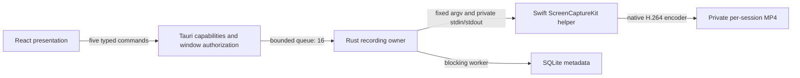

# Architecture

## Standalone extension

The clarified primary deliverable is `apps/chrome-extension`: a persistent recorder document, local MediaRecorder/Web Audio pipeline and dedicated VideoFrame/OffscreenCanvas worker for camera composition, IndexedDB chunks and a narrow toolbar worker. No desktop application is required. See ADR 0003 and 0005, EXTENSION_SECURITY.md and EXTENSION_TESTING.md. The desktop architecture below is retained as a separate, unverified track.

Chripify is an early local-first desktop implementation, not yet production validated.

## Responsibilities

- `src/contracts.ts`: desktop IPC types and presentation rules. `useRecorder.ts`: application interaction and non-overlapping status polling. `App.tsx`: studio, metadata library, settings presentation. Theme is a non-sensitive localStorage preference.
- `domain.rs`: lifecycle and input validation. Pause/cancel exist in the domain contract but are not exposed as implemented features.
- `controller.rs`: bounded request actor, exclusive child ownership, deadlines, low-space polling, native success acknowledgment, idempotent stop while finalizing/completed. No media crosses IPC.
- `storage.rs`: private app directory, application-generated UUID destinations, parameterized SQLite queries, positive-size validation and durable media sync before metadata insertion. Library queries return at most 200 rows.
- `native/Capture.swift`: macOS 15+ enumeration, explicit permission request, ScreenCaptureKit stream and native H.264 MP4 recording output. Frame queue depth 3; output limited to 1920 pixels on the longest edge, even dimensions. Framework timestamps and encoding remain native. EOF on stdin requests shutdown if the parent disappears.

Production UI contains no filesystem, shell, HTTP, dialog or opener plugin. User paths and encoder arguments never enter the capture API. Main-window capability grants exactly five application commands. Rust also checks the invoking window label. CSP denies external connections and executable code; development Vite requires Tauri's development CSP handling.

## Lifecycle and failure behavior

`Idle → Preparing → Recording → Finalizing → Completed`; failures retain partial files and enter Failed. The actor accepts another start only from terminal states. Successful preparation means a process launched; actual Recording requires ScreenCaptureKit's recording-start callback. Completed requires finish callback, successful child exit, non-empty file, filesystem sync and SQLite commit.

Startup is limited to 20 seconds; finalization to 15 seconds; success exit is reaped within 3 seconds. Before recording and every 2 seconds during recording, require at least 512 MiB free. Low space requests graceful stop; it is a reserve, not a guarantee against concurrent writers or very high bitrates. SQLite and disk operations run on blocking workers after initialization.

Main-window close is blocked during preparation/capture/finalization. Stop explicitly before closing. Force quit and power failure may leave an unplayable MP4; no recovery guarantee is made. Native MP4 output is progressive but lacks an independently recoverable fragment design. A future writer slice must evaluate fragmented MP4/MKV before claiming crash recovery.

## Extension points

Do not add a generic media framework now. When the second OS adapter exists, extract a small capture control interface around the demonstrated common contract. Camera compositing and audio timestamp pipelines require a separate ADR: native SCRecordingOutput cannot accept our future composited video frames directly.

## Limitations

No native integration build has been verified without Rust. No pause/resume, arbitrary save directory, system/microphone audio, window capture, multiple-display composition, camera, effects, playback, deletion, extension pairing, signed release or updates. The browser view is an explicit non-recording preview; there is no simulated success path.
